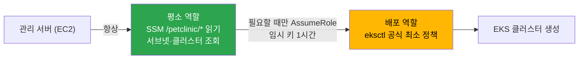

# LFD121 Ch.4 — 최소 권한 (Least Privilege)

> **한 줄 요약:** 사용자·프로세스·서버는 **자기 일에 필요한 권한만** 가져야 한다. 그래야 뚫렸을 때 피해가 그 권한 안에서 멈춘다.

---

## ① 개념 (내 말로)

- 권한은 "혹시 몰라서" 주는 게 아니라 **하는 일 목록에서 거꾸로** 정한다.
- 자주 하는 일과 가끔 하는 위험한 일은 **권한을 나눈다**. 위험한 권한은 필요할 때만 잠깐 빌린다.
- 목적은 사고를 막는 게 아니라 **사고가 났을 때 피해 범위를 줄이는 것**이다. 서버를 빼앗겨도 공격자는 그 서버의 권한만큼만 할 수 있다.

---

## ② 내 프로젝트의 원래 상태

| 프로젝트 | 위치 | 문제 |
|---|---|---|
| [multicloud-dr-petclinic](https://github.com/zeldaim/multicloud-dr-petclinic) | [`infra/aws/environments/dev/main.tf` 87~89행](https://github.com/zeldaim/multicloud-dr-petclinic/blob/main/infra/aws/environments/dev/main.tf#L87-L89) | 관리 서버(EC2)에 **`AdministratorAccess`** — 모든 동작 · 모든 리소스 |

이유는 코드 주석에 있었다: *"EKS 클러스터 생성 및 관리를 위해 필요"*. 클러스터를 **가끔** 만들기 위해 **항상** 관리자 권한을 쥐고 있던 것.

---

## ③ 적용 — 권한을 "평소"와 "배포"로 나눔

| 하는 일 | 근거 | 받은 권한 | 어느 역할 |
|---|---|---|---|
| RDS 접속 정보 읽기 | `user_data_mgmt.sh` 125·126행 | `ssm:GetParameter` — `/petclinic/*` 만 | 평소 |
| 서브넷 조회 | 같은 파일 204행 | `ec2:DescribeSubnets` | 평소 |
| kubectl 접속 준비 | eksctl·kubectl 설치 | `eks:DescribeCluster` — `cluster/petclinic*` 만 | 평소 |
| 클러스터 만들기 | eksctl | EC2 · CloudFormation · EKS · IAM(`eksctl-*` 만) | **배포 (1시간)** |

결과물: [`least-privilege/`](https://github.com/zeldaim/multicloud-dr-petclinic/tree/main/least-privilege) — 기존 코드는 그대로 두고 대체안으로 작성.

---

## ④ 검증

| 방법 | 결과 | 원본 |
|---|---|---|
| `terraform test` + mock (계정 없이) |  | [test.txt](https://github.com/zeldaim/multicloud-dr-petclinic/blob/main/least-privilege/results/test.txt) |
| 음성 시험 — 일부러 틀리게 |  | [SSM 전체](https://github.com/zeldaim/multicloud-dr-petclinic/blob/main/least-privilege/results/test_negative_ssm_all.txt) · [12시간 키](https://github.com/zeldaim/multicloud-dr-petclinic/blob/main/least-privilege/results/test_negative_session.txt) |
| 직접 만든 검증기 — 권한 이름을 AWS 공식 목록과 대조 |  | [verify_actions.md](https://github.com/zeldaim/multicloud-dr-petclinic/blob/main/least-privilege/results/verify_actions.md) |
| Checkov 3.4.5 | -2DA44E?style=flat-square) | [checkov 결과](https://github.com/zeldaim/multicloud-dr-petclinic/tree/main/least-privilege/results) |

**검증이 잡아 준 내 실수:** 처음엔 `eks:DescribeCluster` 를 "조회라서 대상 지정이 안 된다"며 `*` 로 뒀다. 검증기가 **"cluster 리소스로 좁힐 수 있음"** 으로 잡았고 고쳤다. → 정책은 사람이든 AI 든 틀리게 쓴다. **쓴 다음 기계로 대조**해야 한다.

---

## ⑤ 전후 비교

| 항목 | 전 | 후 |
|---|---|---|
| 서버가 **항상** 가진 권한 | -E5534B?style=flat-square) |  |
| 클러스터 생성 권한 |  |  |
| IAM 쓰기 권한 |  |  |
| 서버를 빼앗기면 |  |  |
| Checkov `CKV_AWS_274` (AdministratorAccess) |  |  |

---

## ⑥ 한계 · 다음

- **문서만 검증했다.** 이 권한으로 서버 스크립트와 eksctl 이 실제로 성공하는지는 실제 AWS 계정에서 확인해야 한다.
- 배포 역할의 `AmazonEC2FullAccess` 는 여전히 넓다 → 실제 계정에서 CloudTrail + IAM Access Analyzer 로 "실제로 쓴 권한"만 남기기.
- 같은 레포의 ESO 정책(`Resource = "*"` 로 모든 비밀값 읽기)은 아직 그대로 — 다음 적용 대상.

---

## Ch.4 의 다른 원칙 — 내 프로젝트 적용 후보

| 원칙 (Saltzer & Schroeder 등) | 내 말로 | 내 프로젝트 후보 | 상태 |
|---|---|---|---|
| **최소 권한** | 필요한 권한만 | 관리 서버 IAM (이 문서) |  |
| **권한 분리** | 위험한 일은 두 단계 이상 거치게 | 평소 → 배포 역할 전환 (이 문서에서 일부) |  |
| **안전한 기본값** | 기본은 막고 필요한 것만 연다 | DR Terraform SSH 기본값 `0.0.0.0/0` ([tf-local](https://github.com/zeldaim/multicloud-dr-petclinic/tree/main/tf-local)에서 발견) |  |
| **완전한 중재** | 요청마다 매번 권한 확인 | API 보안 프로젝트의 BOLA (다른 사람 ID 로 조회) |  |
| **입력 검증** | 믿을 수 있는 쪽에서 검증 | — |  |
| **보호 · 탐지 · 대응** | 막는 것만으로 부족, 알아채고 대응 | Wazuh 탐지 → Event-Driven Ansible 자동 차단 (기존 작업과 연결) |  |
