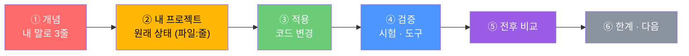

  

  
  
  

OpenSSF 무료 과정을 들으며 **개념을 내 말로 정리하고, 내 프로젝트에 실제로 적용하고, 전후를 검증해 비교**한 기록이다.
강의 요약만 쌓지 않는다 — 각 글에는 **바꾼 코드 링크와 검증 결과**가 있다.

## 🔁 방법

새 글은 [`TEMPLATE.md`](TEMPLATE.md) 형식으로 쓴다.

## 📊 진행 현황

| 과정 | 장 | 개념 | 적용한 프로젝트 | 상태 |
|---|---|---|---|---|
| **LFD121** Developing Secure Software | Ch.4 | [최소 권한](LFD121/ch04-least-privilege.md) | multicloud-dr-petclinic — 관리 서버 IAM |  |
| | Ch.5 · next | 외부 소프트웨어를 안전하게 쓰기 | API 보안 · 공급망 (SBOM · VEX) |  |

## 🏁 지금까지 전후 비교 한눈에

| 개념 | 전 | 후 | 근거 |
|---|---|---|---|
| 최소 권한 |  |  | test 4/4 · 검증기 ERROR 0 · Checkov `CKV_AWS_274` FAILED→PASSED |

## 📚 과정 출처

- [OpenSSF Training](https://openssf.org/training/courses/) — Linux Foundation 무료 과정. 글은 강의 원문이 아니라 **내 말로 쓴 정리**다.
